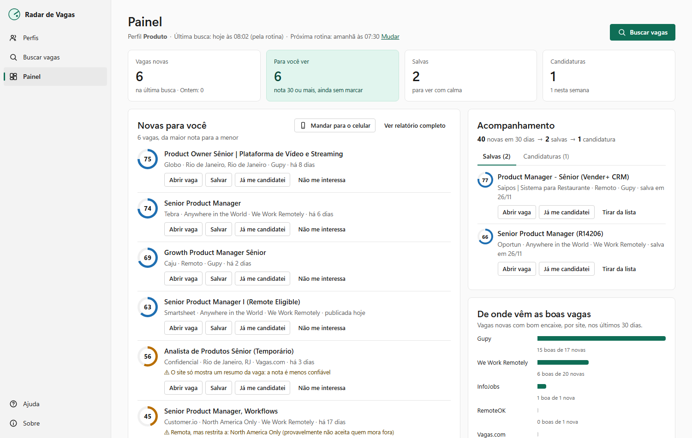
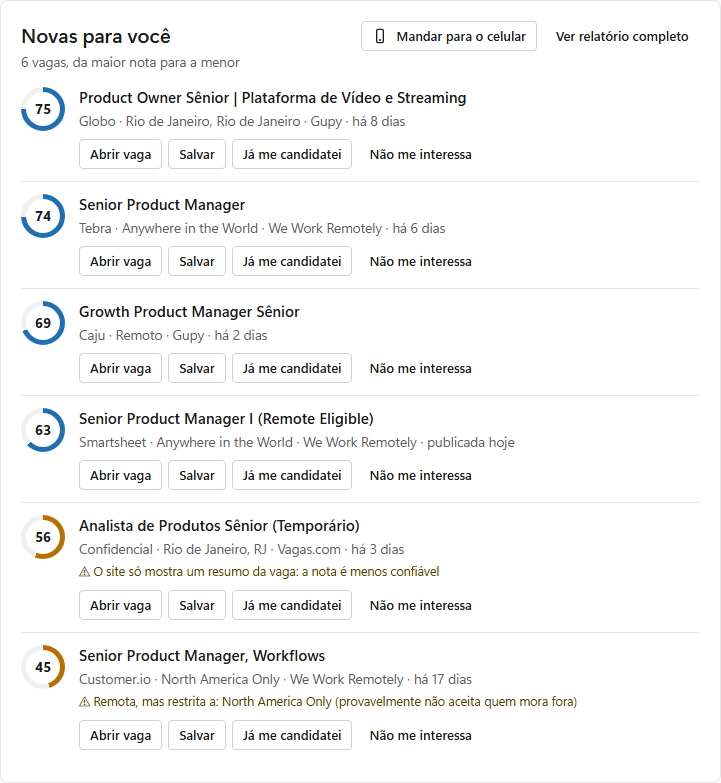

# Radar de Vagas

**Todo dia, as vagas novas que mais combinam com você, de vários sites, com a nota explicada.**
Um programa para Windows, grátis para uso pessoal, que roda no **seu** computador, não pede login e **nunca se candidata por você**.

  

  Baixou? Dê dois cliques no arquivo. Se o Windows avisar que "protegeu o computador", clique em <b>Mais informações</b> e depois em <b>Executar assim mesmo</b>. 
  <a href="https://github.com/pedrin-ma/radar-de-vagas/releases/latest/download/Como-usar-o-Radar-de-Vagas.pdf">Manual com as telas (PDF)</a>

## Para quem é

Para quem trabalha (ou quer trabalhar) com tecnologia no Brasil e está procurando vaga: **desenvolvimento** (back-end, front-end, full stack, mobile), **QA e testes**, **produto** (PO e PM), **dados e IA**, **UX**, **análise de negócios**, **processos e RPA**, **projetos e agilidade**, **sistemas**, **infraestrutura e DevOps** e **segurança**.
Também funciona para outras áreas (RH, vendas, administrativo...), mas o foco e os testes são da área de tecnologia.

## Por que ele existe

Procurar vaga é abrir vários sites, repetir a mesma busca, ver as mesmas vagas duplicadas e perder tempo com vaga velha, de outra cidade ou de outro cargo. O Radar faz isso por você: **busca em vários sites, junta, tira duplicatas, dá uma nota de 0 a 100 e mostra primeiro as vagas novas que mais combinam**. Você decide e se candidata.
Nasceu de uma necessidade real: ajudar colegas de tecnologia que estavam em busca de recolocação.

## Como usar (Windows 10 ou 11, uns 5 minutos)

1. **Baixe o `Radar-de-Vagas.exe`** no botão verde lá em cima (ou na página de [Releases](https://github.com/pedrin-ma/radar-de-vagas/releases/latest)). Não precisa de conta no GitHub.
2. **Dê dois cliques nele.** Aparece uma barrinha por alguns segundos e o programa abre sozinho, com um ícone na Área de Trabalho. Não precisa instalar Python nem nada antes, e não pede senha de administrador.
   - Se aparecer **"O Windows protegeu o computador"**, clique em **Mais informações** e depois em **Executar assim mesmo**. O aviso aparece porque o programa é novo e gratuito, sem a "assinatura digital" paga das grandes empresas.
3. **Crie o seu perfil:** anexe o currículo (PDF ou foto) ou o PDF do seu perfil do LinkedIn, ou responda 3 perguntas. O Radar preenche quase tudo sozinho.
4. **Busque:** ao salvar o perfil, o programa já abre em **Buscar vagas**; é só clicar no botão **Buscar vagas** (3 a 5 minutos).
5. **Veja o que é novo no Painel** e, se quiser, **agende uma rotina** para o Radar buscar sozinho todo dia, mesmo com o programa fechado.

O passo a passo ilustrado está no **Como-usar-o-Radar-de-Vagas.pdf**, na mesma página de [Releases](https://github.com/pedrin-ma/radar-de-vagas/releases/latest). Já usava uma versão antiga (o zip com "Abrir o Radar de Vagas")? Em **Perfis**, clique em **Trazer de uma versão antiga**: o perfil, as vagas já vistas e as buscas antigas vêm junto.

**Mac e Linux:** por enquanto, só Windows.

## O que tem no programa

- **Painel:** as vagas novas da última busca (só as que você ainda não tinha visto), quantas vagas novas chegaram em cada dia, de quais sites vêm as boas vagas e **Comparar dias** (o que entrou, o que saiu e o que continua).
- **Acompanhamento:** em cada vaga, **Salvar**, **Já me candidatei** ou **Não me interessa** (e ela não volta mais). Dá para desfazer.
- **Vários perfis:** um por tipo de vaga, ou um para outra pessoa. Cada um com o próprio painel e a própria rotina.
- **Rotina:** o Radar busca sozinho no horário que você escolher (todo dia ou só nos dias úteis), pelo Agendador do próprio Windows, e avisa quando termina.
- **Relatório do dia:** a página completa de vagas, com a conta de cada nota, para abrir ou salvar uma cópia.

## Para ver no celular

No Painel, em **Novas para você** (ou em **Relatórios**, para os dias anteriores), clique em **Mandar para o celular** e escolha **Só as novas** ou **As melhores do dia**: sai um **PDF** com o link embaixo de cada vaga. Mande o PDF para o seu WhatsApp e toque nos links. O botão **WhatsApp** copia um texto pronto para colar numa conversa.

## O que ele faz (e o que não faz)

| Faz | Não faz |
|---|---|
| Busca em vários sites e junta as vagas repetidas | Não se candidata a nada por você |
| Dá nota de 0 a 100 e **mostra a conta** de cada nota | Não entra na sua conta de nenhum site |
| Mostra só o que é novo e guarda o que você já decidiu | Não envia o seu currículo nem seus dados para ninguém |
| Avisa de vaga remota restrita a outro país, vaga em inglês, vaga antiga | Não garante que a vaga ainda esteja aberta |

A nota é uma **estimativa por regras** (cargo, suas palavras-chave, local, recência), não uma garantia. Leia a vaga antes de se candidatar.

## De onde vêm as vagas

Gupy, InfoJobs e Vagas.com (vagas no Brasil; já vêm marcadas) e We Work Remotely e RemoteOK (vagas remotas, em inglês; você escolhe). O Painel mostra quais estão trazendo vagas boas para você.

O Radar **só lê sites que permitem a leitura por robôs**: antes de cada página ele confere as regras do site (o arquivo `robots.txt`), se identifica como "Radar de Vagas", faz pausas e para quando o site recusa.

O Radar de Vagas **não tem vínculo, parceria nem autorização** desses sites. Os nomes aparecem aqui só para dizer de onde vêm as vagas, e as marcas pertencem aos seus donos.

## Privacidade

- **Tudo roda no seu computador.** Não existe servidor do projeto, não há conta, cadastro nem coleta de dados (telemetria).
- O currículo é lido **dentro do programa**, no seu computador; nada sai dele.
- Seus perfis, o histórico de buscas, o que você marcou e os relatórios ficam em `Documentos › Radar de Vagas` (se a sua pasta Documentos é sincronizada com o OneDrive, eles vão para o **seu** OneDrive).
- As telas do programa são mostradas pelo próprio Windows (WebView2), servidas **só para o seu computador** (endereço 127.0.0.1, que ninguém de fora alcança).
- O programa só faz acessos de leitura aos sites de vagas, a partir do seu computador.

## Aviso legal

O Radar de Vagas é uma ferramenta de **uso pessoal**. Ele lê **só sites de vagas que permitem a leitura por robôs**, segue as regras de cada um (`robots.txt`), se identifica como Radar de Vagas, faz pausas entre os acessos e para quando um site recusa. Não usa login e não se candidata. **Esses sites têm regras próprias**; ao usar o programa, você concorda em respeitá-las.
O programa é oferecido **como está, sem garantia** (veja a [licença](LICENSE)). Isto não é aconselhamento jurídico.

## Problemas ou ideias

- Deu erro? No programa, **Ajuda › Algo deu errado? › Gerar diagnóstico**: ele copia um texto **sem dados pessoais** (sem cargos, cidade, currículo nem nomes). Abra um [relato de problema](https://github.com/pedrin-ma/radar-de-vagas/issues/new) e cole esse texto.
- O projeto é mantido por uma pessoa, no tempo livre, **sem suporte garantido**. Relatos bem descritos ajudam muito.
- Tem uma ideia (uma fonte, uma área, um ajuste)? Abra uma [sugestão](https://github.com/pedrin-ma/radar-de-vagas/issues/new).

## Créditos e licença

Feito por **Pedro Moura Araujo** ([LinkedIn](https://www.linkedin.com/in/pedroigormoura/)).

**Licença:** gratuito para uso pessoal, **código fechado** e todos os direitos reservados (veja a [licença](LICENSE)). Você pode usar e indicar o programa, mas não copiar, modificar, vender nem usar comercialmente sem autorização. As versões 1.6.0 e 1.6.1 foram publicadas sob a licença MIT e continuam regidas por ela.

Usa o [pywebview](https://pywebview.flowrl.com) (BSD) para a janela, o [pdf.js](https://github.com/mozilla/pdf.js) (Apache-2.0) para ler o currículo em PDF e o [tesseract.js](https://github.com/naptha/tesseract.js) (Apache-2.0) para ler currículos em imagem. O programa é montado com o [PyInstaller](https://pyinstaller.org) e o instalador com o [Inno Setup](https://jrsoftware.org/isinfo.php). As vagas remotas do [RemoteOK](https://remoteok.com) e do [We Work Remotely](https://weworkremotely.com) são citadas no relatório, como os termos deles pedem. O aviso de licença de cada biblioteca está no programa, em **Sobre › Licenças de terceiros**.
